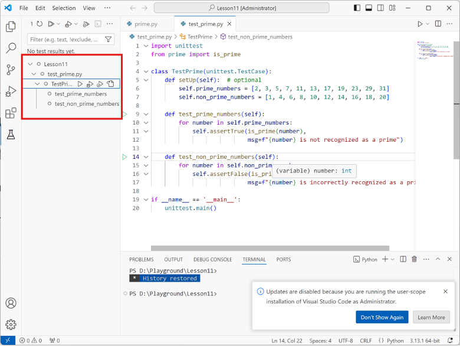
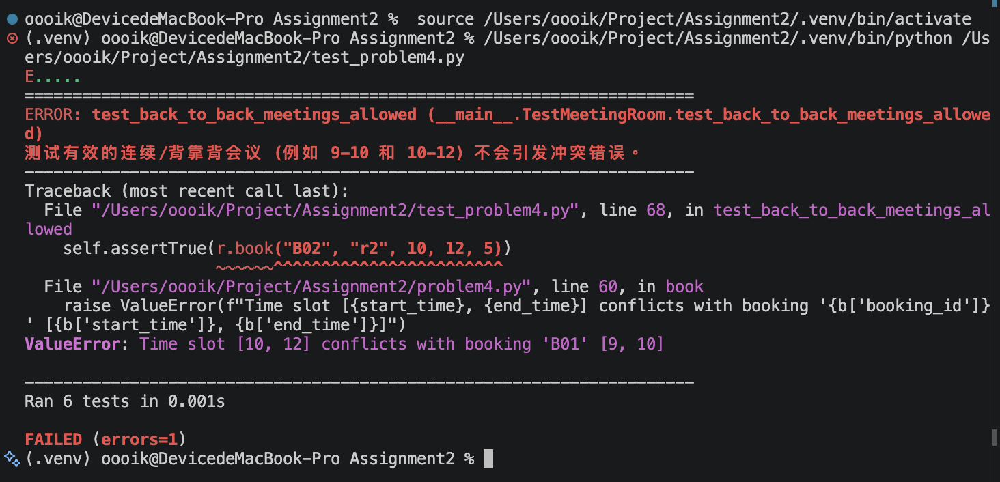
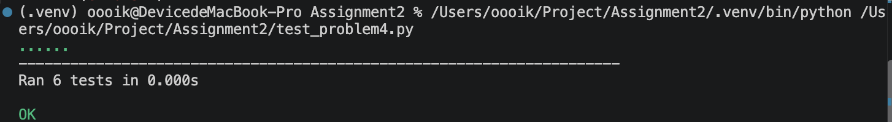
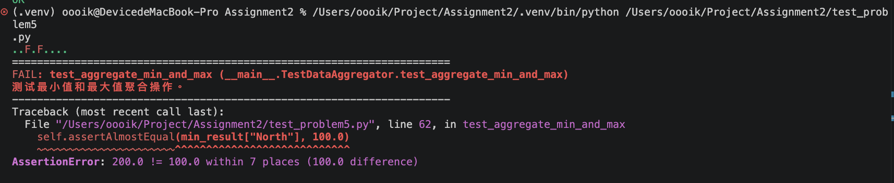
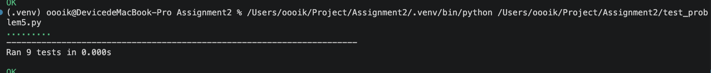
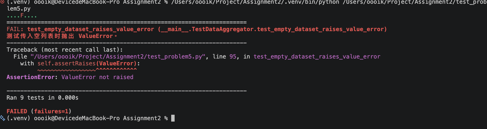

# 问题/错误报告 Bug Report

该报告记录了在有错误程序中发现的问题（bugs），包括失败的测试用例、根本原因分析（root cause analysis）以及已应用的修复方案。

---

## 问题/错误报告 1：（示例）

### 1. 测试程序 Program Under Test
- **File:** `problemX.py`
- **Class / Function:** `YourClassName.method_name()`

### 2. 失败的测试用例 Failing Test Case
提供来自 `test_problemX.py` 的单元测试代码，用于暴露该缺问题/错误并在执行过程中失败：

```python
# 在此粘贴失败的测试方法
def test_example_failure(self):
    pass
```

提供从 VS Code 中捕获的测试运行结果。



**测试输出 / 错误信息：**
```text
# 在此粘贴错误追踪 / 断言失败信息（error traceback / assertion failure message）
```

### 3. 根本原因分析 Root Cause Analysis
说明该问题/错误（bug）为何会发生，以及它导致了什么错误行为：
- **预期行为：**（根据规范应发生什么）
- **实际行为：**（起始代码中实际发生了什么）
- **根本原因：**（对代码逻辑中问题/错误的解释）

### 4. 代码修复与差异 Code Fix & Diff
展示对 `problemX.py` 进行修复所做的修改：

```diff
- # Original buggy code line
+ # Corrected code line
```

---

## 问题/错误报告 2：（你的发现）

按上述方式记录你发现的问题/错误及其解决方案。必要时可以添加更多问题报告。
### 1. 测试程序 Program Under Test

- **File:** `problem4.py`
- **Class / Function:** `MeetingRoom.book()`

### 2. 失败的测试用例 Failing Test Case

测试文件：`test_problem4.py`

```python
def test_back_to_back_meetings_allowed(self):
    r = self.room

    self.assertTrue(r.book("B01", "r1", 9, 10, 5))
    self.assertTrue(r.book("B02", "r2", 10, 12, 5))
    self.assertTrue(r.book("B00", "r3", 8, 9, 10))

    self.assertEqual(
        [b["booking_id"] for b in r.bookings],
        ["B00", "B01", "B02"]
    )
    self.assertEqual(r.total_hours_booked, 4)
    self.assertAlmostEqual(r.get_utilization_rate(), 0.4)
    self.assertEqual(r.get_free_slots(), [(12, 18)])
```

**测试输出 / 错误信息：**

```text
Traceback (most recent call last):
  File "/Users/oooik/Project/Assignment2/test_problem4.py", line 68, in test_back_to_back_meetings_allowed
    self.assertTrue(r.book("B02", "r2", 10, 12, 5))
                    ~~~~~~^^^^^^^^^^^^^^^^^^^^^^^^
  File "/Users/oooik/Project/Assignment2/problem4.py", line 60, in book
    raise ValueError(f"Time slot [{start_time}, {end_time}] conflicts with booking '{b['booking_id']}' [{b['start_time']}, {b['end_time']}]")
ValueError: Time slot [10, 12] conflicts with booking 'B01' [9, 10]
```
**测试截图：**


### 3. 根本原因分析 Root Cause Analysis

- **预期行为：**
  9–10 和 10–12 两场会头尾挨着，不重叠，可以预订。

- **实际行为：**
  第一场订成功，订第二场时报错，误判成时间冲突。

- **根本原因：**
  判断冲突用了严格大于、严格小于。新会议开始时间等于旧会议结束时间时，识别成冲突了

### 4. 代码修复与差异 Code Fix & Diff

将判断中的 `<` 改为 `<=`，将 `>` 改为 `>=`，
允许两场会议的边界时间相等。

```diff
- if not (end_time < b["start_time"] or start_time > b["end_time"]):
+ if not (end_time <= b["start_time"] or start_time >= b["end_time"]):
```

重新运行：

```bash
python3 -m unittest test_problem4.py -v
```
**测试截图：**



## 问题 3：

### 1. 测试程序 Program Under Test

- **File:** `problem5.py`
- **Function:** `clean_and_aggregate()`

### 2. 失败的测试用例 Failing Test Case

测试文件：`test_problem5.py`

```python
def test_aggregate_min_and_max(self):
    min_result = clean_and_aggregate(
        self.sample_sales,
        group_by="region",
        metric="sales",
        aggregation="min"
    )

    max_result = clean_and_aggregate(
        self.sample_sales,
        group_by="region",
        metric="sales",
        aggregation="max"
    )

    self.assertAlmostEqual(min_result["North"], 100.0)
    self.assertAlmostEqual(max_result["North"], 200.0)
    self.assertAlmostEqual(min_result["South"], 150.0)
    self.assertAlmostEqual(max_result["South"], 350.0)
```

**测试输出 / 错误信息：**

```text
..F.F....
======================================================================
FAIL: test_aggregate_min_and_max (__main__.TestDataAggregator.test_aggregate_min_and_max)
测试最小值和最大值聚合操作。
----------------------------------------------------------------------
Traceback (most recent call last):
  File "/Users/oooik/Project/Assignment2/test_problem5.py", line 62, in test_aggregate_min_and_max
    self.assertAlmostEqual(min_result["North"], 100.0)
    ~~~~~~~~~~~~~~~~~~~~~~^^^^^^^^^^^^^^^^^^^^^^^^^^^^
AssertionError: 200.0 != 100.0 within 7 places (100.0 difference)
```

**测试截图：**



### 3. 根本原因分析 Root Cause Analysis

- **预期行为：**
  North 组的数据为 100 和 200，最小值应为 100，最大值应为 200。

- **实际行为：**
  最小值计算返回了 200，最大值计算返回了 100。

- **根本原因：**
  程序将 min 和 max 的实现写反了。

### 4. 代码修复与差异 Code Fix & Diff

```diff
  elif agg_op == "min":
-     val = max(values)
+     val = min(values)
  elif agg_op == "max":
-     val = min(values)
+     val = max(values)
```


运行：

```bash
python3 -m unittest test_problem5.py -v
```



---

## 问题 四：

### 1. 测试程序 Program Under Test

- **File:** `problem5.py`
- **Function:** `clean_and_aggregate()`

### 2. 失败的测试用例 Failing Test Case

测试文件：`test_problem5.py`

```python
def test_empty_dataset_raises_value_error(self):
    with self.assertRaises(ValueError):
        clean_and_aggregate(
            [],
            group_by="region",
            metric="sales"
        )
```

**测试输出 / 错误信息：**

```text
AssertionError: ValueError not raised
```

**测试截图：**



### 3. 根本原因分析 Root Cause Analysis

- **预期行为：**
  根据函数说明，传入空列表时应抛出 ValueError。

- **实际行为：**
  函数没有抛出异常，而是返回了空字典 {}。

- **根本原因：**
  函数缺少对 records 为空的校验。空列表跳过了分组聚合循环，直接返回空字典。

### 4. 代码修复与差异 Code Fix & Diff

在函数的 docstring 结束后、聚合操作检查之前添加输入检查。
先验证输入是列表，再检查列表是否为空。

```diff
+ if not isinstance(records, list):
+     raise TypeError("records must be a list")
+
+ if not records:
+     raise ValueError("records cannot be empty")
+
  valid_aggregations = {"sum", "mean", "min", "max", "count"}
```

类型检查同时确保非列表输入按规格抛出 TypeError。


运行：

```bash
python3 -m unittest test_problem5.py -v
```


